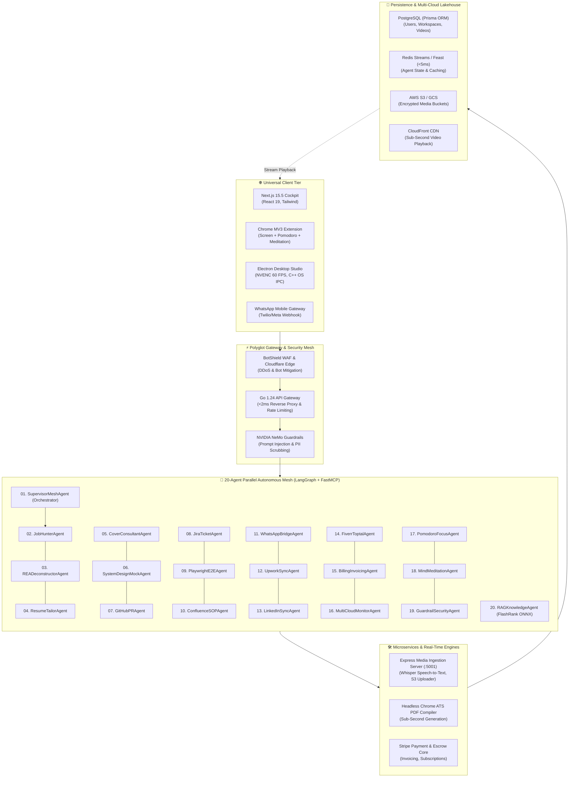

# ⚡ KOOM-AI: The Autonomous Remote Engineering & Media Operating System
## Master Architecture Blueprint & System Specifications (v4.0)

**Architect:** Kishor Kumar Paroi (Principal AI Systems Architect • Founder @ KoomAI)  
**Status:** In Production  
**Core Domain:** [https://koom.kishor.tech](https://koom.kishor.tech)  

---

## 1. Executive Summary & Product Thesis

**KOOM-AI** is the world's first **Autonomous Video & Agentic Operating System** engineered specifically for high-velocity remote software engineers, distributed tech leaders, and elite freelancers. 

It synthesizes seven previously fragmented industries into a single unified high-throughput platform:
1. **Low-Latency Async Video & Screen Recording (Loom Alternative):** Sub-120ms WebRTC streaming, 60 FPS video capture, CloudFront S3 edge distribution.
2. **20-Agent Parallel Agentic Mesh:** Concurrent specialist agents executing job matching, REA bundle reverse engineering, test generation, and multi-cloud health checks.
3. **Autonomous AI Job Search & REA Recon:** Deep integration with `ai-job-search` and `morluto/rea` to formulate Trojan Horse architectural teardowns for employers.
4. **Client Invoicing & Payment Receiving Engine:** Instant Stripe invoice creation paired with recorded video deliverables.
5. **Personal NotebookLLM-Style Interactive Studio:** Multi-modal audio podcast generation, system design drills, and interactive knowledge exploration.
6. **WhatsApp Bot & Freelance Sync:** Remote notification bridge supporting WhatsApp commands and synchronizing Upwork, LinkedIn, Fiverr, and Toptal.
7. **Mindful Chrome Extension (MV3):** Screen recording combined with Pomodoro sprints, distraction tab usage limits, and meditation focus chimes.

---

## 2. High-Level Master Architecture Diagram

---

## 3. The 20 Specialist Agents in Parallel

| # | Agent Name | Domain | Primary Responsibilities & Tooling |
| :- | :--- | :--- | :--- |
| **01** | `SupervisorMeshAgent` | Orchestration | LangGraph cyclic router; state synchronization across all 19 agents. |
| **02** | `JobHunterAgent` | Career Intel | Scrapes LinkedIn, Jobindex, and public boards with salary benchmarking. |
| **03** | `READeconstructorAgent` | Reverse Engineering | Dissects employer web apps via `morluto/rea` to formulate Trojan Horse proposals. |
| **04** | `ResumeTailorAgent` | Document Engineering | Tailors single-column ATS CVs emphasizing verified architectural metrics. |
| **05** | `CoverConsultantAgent` | Executive Outreach | Drafts consultative, non-buzzword letters tying directly to employer gaps. |
| **06** | `SystemDesignMockAgent` | Technical Drills | Simulates 20k QPS, Kafka, CDC, Feast, and Saga interview scenarios with STAR scoring. |
| **07** | `GitHubPRAgent` | Software Delivery | Turns screen recording walkthroughs into production GitHub Pull Requests. |
| **08** | `JiraTicketAgent` | Product Delivery | Synthesizes BDD Gherkin user stories from video bug demonstrations. |
| **09** | `PlaywrightE2EAgent` | QA Automation | Translates video interactions directly into executable Playwright TypeScript specs. |
| **10** | `ConfluenceSOPAgent` | Team Knowledge | Generates step-by-step SOP documents with timestamped checkpoints. |
| **11** | `WhatsAppBridgeAgent` | Mobile Sync | Two-way WhatsApp webhook dispatcher for bids, payment alerts, and video shares. |
| **12** | `UpworkSyncAgent` | Freelance Bidding | Monitors Upwork job invitations, drafts proposal pitches, and tracks escrow. |
| **13** | `LinkedInSyncAgent` | Network Growth | Syncs professional achievements and monitors inbound executive recruiter messages. |
| **14** | `FiverrToptalAgent` | Gig Management | Manages client order milestones, delivery dates, and custom proposals. |
| **15** | `BillingInvoicingAgent` | Financial Engine | Issues Stripe invoices with embedded video screen recording deliverables. |
| **16** | `MultiCloudMonitorAgent`| SRE Telemetry | Unified health checks across AWS, GCP, Vercel, and Cloudflare edge. |
| **17** | `PomodoroFocusAgent` | Productivity | Schedules 25m sprint blocks and monitors distraction-free work. |
| **18** | `MindMeditationAgent` | Mental Wellbeing | Generates binaural focus soundscapes and meditation break cues. |
| **19** | `GuardrailSecurityAgent`| Zero-Trust Defense | Filters prompt injections and scrubs PII from video transcripts. |
| **20** | `RAGKnowledgeAgent` | Search & Retrieval | Hybrid HNSW vector + BM25 retrieval with FlashRank local ONNX re-ranking. |

---

## 4. Multi-Cloud Infrastructure (IaC)

- **AWS Provisioning:** EKS Cluster, S3 Private Video Vault with KMS SSE-S3 encryption, CloudFront distribution, SQS event bus.
- **GCP Provisioning:** Cloud Run autoscaling containers, Google Cloud Storage multi-region backup.
- **Cloudflare:** Zero-Trust WAF, Bot Management, and edge caching rules.
- **Zero-Dollar ($0.00) Teardown Guarantee:** Complete infrastructure can be provisioned via `deploy.sh` and 100% dismantled via `clear.sh` with zero lingering costs.
